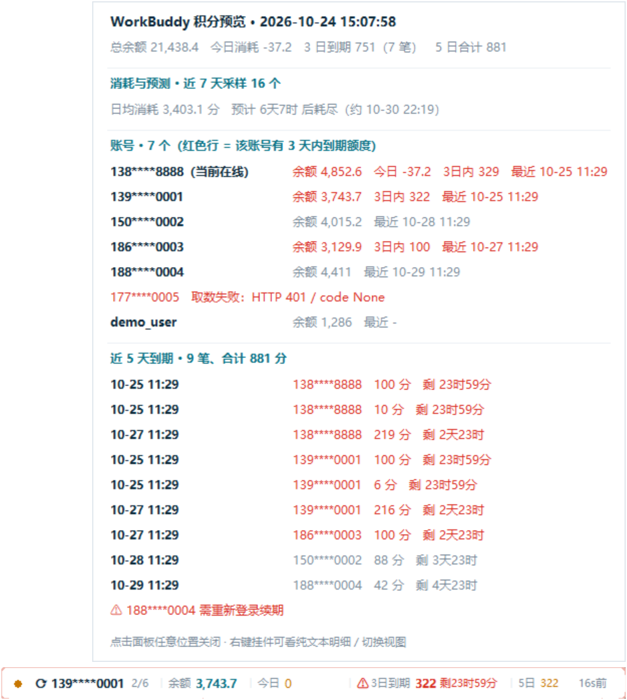
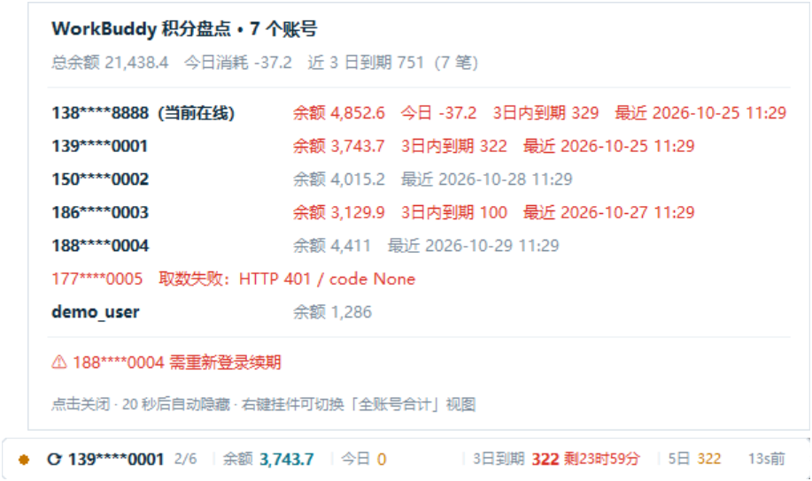

# WorkBuddy 积分挂件

常驻屏幕底部的悬浮小挂件：**实时显示积分余额、今日消耗、近 3 / 5 天即将过期的积分与倒计时，并按消耗速度预测「还能用多久」**。
纯 Python 标准库（tkinter + urllib），无第三方依赖，无需联网安装任何包。

**生命周期跟着 WorkBuddy 走**：打开客户端它就出现，关掉客户端它就结束；
开机时**不会**弹任何窗口（只留一个无界面监听器在等 WorkBuddy）——
详情见 [2.0 为什么需要一个「监听器」](#20-为什么需要一个监听器重要)。






> 截图均为**合成数据**，不含真实账号与余额。

---

## 1. 为什么是「悬浮挂件」而不是真的嵌进客户端底边栏

WorkBuddy 客户端界面打包在 `app.asar` 里，属于签名应用，无法从外部安全地注入一段常驻 UI 到底边栏。
强行改包会在客户端升级时失效，也可能导致客户端无法启动。

所以这里用**同样视觉风格的外部置顶挂件**实现同样效果：

- 拖动它到 WorkBuddy 输入框底边栏、与模型选择器（Deepseek-V4.1-Flash 那一行）齐平即可；
- 挂件始终置顶，位置会记住，视觉上就是底边栏的一部分。

## 2. 启动 / 停止

**默认行为：挂件的生命周期完全跟着 WorkBuddy 走 —— 客户端开着它就在，客户端关了它就结束。**

| 操作 | 方式 |
| --- | --- |
| **随 WorkBuddy 自动启停（默认，已配置）** | 登录时启动的是一个**无界面监听器**（不是挂件窗口）：WorkBuddy 一启动 → 挂件自动出现；WorkBuddy 一退出 → 挂件进程自动结束 |
| 手动启动挂件 | 双击 `start_widget.vbs`（无黑窗口）；被安全策略拦截时双击 `start_widget.bat`。手动启动的实例**不受**"WorkBuddy 退出就结束"约束 |
| 只用监听器、不要开机项 | 双击 `watch_widget.bat`（本次开机内生效） |
| 停止 | 双击 `stop_widget.bat`（会先停监听器再停挂件，顺序反了会被监听器重新拉起），或右键挂件 → 退出挂件 |
| 取消 / 恢复自启项 | 双击 `autostart_off.vbs` / `autostart_on.vbs`；或右键挂件 → **随 WorkBuddy 自动启动** |
| 查看运行状态 | `python wb_credit_widget.py --autostart status`（自启项 / 监听器 / 挂件 / WorkBuddy 四项状态），或右键 → 随 WorkBuddy 自动启动 → **查看监听状态** |
| 找回挂件 | 先在任务管理器确认 WorkBuddy 在跑；右键 → **复位到右下角**；或 `stop_widget.bat` 后重新启动 |

> 挂件带**单实例保护**：重复启动会弹提示，不会出现两个挂件。
> 显示后 **3.5 秒内边框会闪烁**（深青 / 红交替），并弹出**多账号盘点面板**，20 秒后自动隐藏。
> 位置只在拖动超过 4px 时才记忆，单击不会误移动（**单击 = 弹出积分预览面板**）。
> 多账号时胶囊会**每 10 秒轮播**一个账号（`⟳ 账号名 3/5`），把剩下的号也同步给你看。

## 2.0 为什么需要一个「监听器」？（重要）

本机的 `schtasks.exe` 被安全策略列进黑名单（计划任务用不了），而 Windows 没有
"某个程序启动时触发"的原生开关。所以要让挂件**恰好**在 WorkBuddy 启动那一刻出现，
就必须有一个东西在等它 —— 这就是**监听器**：

```
登录  ──► 监听器（无窗口、无网络，只每 1.5 秒看一眼进程表）
             │
WorkBuddy 启动 ──► 拉起挂件 ──► 胶囊出现在屏幕上
             │
WorkBuddy 退出 ──► 结束挂件进程 ──► 桌面恢复干净，不留后台
```

- **挂件窗口本身不在开机项里**：登录后你不会看到它，也不会看到任何闪烁的窗口；
- 监听器很轻：只在内存里轮询 `workbuddy.exe`，不联网、不显示界面；
- 监听器自己如果被关掉，挂件不受影响（只是下次 WorkBuddy 启动时不会自动出现）；
- **完全不想要任何开机项**：双击 `autostart_off.vbs`（或右键菜单里移除），
  之后改用 `watch_widget.bat` / `start_widget.vbs` 手动控制。

打开客户端后由监听器自动拉起的样子（顺手弹一次多账号盘点）：


### 2.0.1 挂件为什么能跟着 WorkBuddy 一起关（判据是「窗口」不是「进程」）

关掉 WorkBuddy 之后，它**并不会马上把所有进程都退掉**。实测开着客户端时有 11 个 `WorkBuddy.exe`，
其中只有 1 个是真正的界面主进程，其余是它的子进程；另外还有一批**关掉窗口后仍会继续存在**的后台辅助进程：

```
D:\WorkBuddy\WorkBuddy.exe                                   ← 主进程（唯一有可见窗口的）
  ├─ --type=gpu-process / --type=renderer / --type=utility     ← 随主进程一起退
  ├─ --type=crashpad-handler                                  ← 可能滞留
  ├─ ...\app.asar\main\daemon-app-server-entry.js --stdio     ┐
  ├─ ...\app.asar\main\sidecar-entry.js --token ...           │ 预热池 / 守护进程，
  ├─ ...\edge-sync\server\index.cjs                           │ 关掉窗口后还在跑
  ├─ ...\cli\bin\codebuddy --prewarm --prewarm-id wb-pool-... │
  └─ ...windows-child-process-containment.cjs --gc_retain_sec 600 ┘
```

它们的映像名**同样是 `WorkBuddy.exe`**。所以早期版本用"还有没有 `WorkBuddy.exe` 进程"来判断
"客户端是否开着"，在这些残留进程赖着不走的时候会一直得到 `True` ——
于是 `exit_with_workbuddy` 永远等不到"客户端已关闭"，**挂件就关不掉**（2026-10-09 的 bug）。

现在判据改成：**是否存在属于 `WorkBuddy.exe` 的可见顶层窗口**。

- 客户端开着 → 一定有一个可见窗口（`class=Chrome_Wi...`，标题 `WorkBuddy`）；
- 关掉窗口 → 那些残留进程**一个窗口都没有** → 判为「已关闭」→ 挂件走正常退出流程；
- **最小化到任务栏不算关闭**：Electron 最小化不会隐藏窗口，`IsWindowVisible` 仍为真；
- 隐藏到托盘会被判为「窗口已关」（这就是你要的语义），托盘里再点回来，监听器会重新拉起挂件；
- 万一窗口枚举失败（理论上不会），退回"进程在就算开着"这个保守行为，绝不因此乱退。

> 想知道此刻到底有几个进程、几个窗口：`python tests\diagnose_dead.py`。

### 2.0.2 监听器为什么不会「以为自己还在跑」（pid 文件身份校验）

监听器自身是**单实例**的，靠 `%LOCALAPPDATA%\WBCreditWidget\watcher.pid` 判断"是不是已经有一个在跑"。
这里踩过一个真实的坑（2026-10-04，现象就是**这次开机挂件没出现**）：

```
硬关机 / 重启  ──► pid 文件的清理代码根本来不及跑
                   磁盘上留下一个"过期 pid"
                   ↓
                 Windows 把这个 pid 分配给了别的程序（这次是 svchost.exe）
                   ↓
                 "_pid_alive(旧pid)" 返回 True  ← 假阳性！
                   ↓
                 登录自启跑 --watch 时以为"前一个还在跑"→ 静默退出
                   ↓
                 挂件永远不会被拉起
```

修法是**给 pid 文件加上"进程身份"**，而不只是 pid：

| 写入 | 读取时的判定 |
| --- | --- |
| 第 1 行：pid<br>第 2 行：进程创建时间（FILETIME） | 三选一不满足就当**过期文件删掉**，视为"没有实例在跑"：<br>① 进程不存在；② 进程活着但**映像不是 python/pythonw**（= pid 被复用）；③ 映像对得上但**创建时间对不上**（= 同名不同进程） |

顺带加固的两处：

- **心跳**：监听器每轮（1.5 秒）刷新 `watcher.heartbeat`。心跳文件存在但超过 **180 秒**没动，
  视为"进程还在但循环卡死"，同样判定为死、清掉 pid 文件好让新监听器起来（否则会永久起不来）；
- **不再误杀**：`--stop-all` 走的是同一套身份校验，绝不会拿着被复用的 pid 去 `os.kill` 一个毫不相干的进程；
- **登录时不弹窗**：`--watch` / `--managed` 发现自己已经有实例在跑时，**静默退出**（只写 watcher.log）。
  登录时弹一个"已经在运行"的对话框只会让人以为程序坏了。

还有一层**互相保活**：挂件每 60 秒看一眼监听器还在不在，
如果监听器已经不在了、而且用户确实装过自启项（`autostart_installed()`），就把它拉回来；
用户主动移除了自启项则不强拉（尊重"我一点后台都不要"的选择）。

## 2.1 随 WorkBuddy 启停

两种"跟随"，可以叠加，也可以各自关掉：

| 行为 | 开关 | 默认 | 说明 |
| --- | --- | --- | --- |
| 客户端不开就不显示 | `follow_workbuddy` | 开 | 右键 → 跟随 WorkBuddy 启停。WorkBuddy 不在时把界面藏起来（进程还在） |
| 客户端关了挂件也结束 | `exit_with_workbuddy` | 开 | 仅对**监听器拉起的**实例生效：WorkBuddy 消失满 `exit_grace_seconds`（默认 8 秒）后，挂件走正常退出流程（落盘当天余额采样 → 删 pid → 销毁窗口） |

- WorkBuddy 闪断（重启客户端、切换账号导致的进程抖动）不会误杀：要连续消失超过宽限秒数才算；
- 手动双击 `start_widget.vbs` 启动的实例**不会**因为 WorkBuddy 退出而消失，方便你脱离客户端单独看数据；
- 监听器侧还有兜底：即使挂件没有自己退，监听器也会在宽限后结束它。

## 2.2 启动盘点面板（开机就能看到所有号）

用 `start_widget.vbs` / 开机自启拉起后，首帧数据到手就会弹出一张面板，列出**全部账号**：

```
WorkBuddy 积分盘点 · 多个账号
总余额 31,836.2　今日消耗 -7.1　近 3 日到期 3,507.2（9 笔）
──────────────────────────────────────────────
138****8888（当前在线）  余额 4,943.8  3日内到期 622.8  最近 2026-09-30 01:12
139****0001       余额 4,583.2  3日内到期 495.2  最近 2026-09-30 23:59
...（每个账号一行）
点击关闭 · 20 秒后自动隐藏 · 右键挂件可切换「全账号合计」视图
```

- 点击面板任意位置立即关闭，否则 20 秒后自动隐藏
- 想随时再看：右键挂件 → **立即看多账号盘点**
- 不想要开机弹窗：右键挂件 → **关闭启动盘点提示**（写入 config 的 `startup_toast`）

## 2.3 到期标红 + 到期提醒（重点）

**标红（无需操作，常驻可见）**
- 有 ≤3 天到期的额度时，胶囊边框变**淡红**并常亮；
- `3日到期` 前面出现**闪烁的 ⚠**，数值以**红色加粗**显示；
- 倒计时（`剩2天10时`）也是红色。

**提醒面板（自动弹出）**
- 触发条件：有批次进入 **≤3 天**（可调）→ 弹面板，红色标题、逐笔列出 `到期时间 / 账号 / 剩余 / 倒计时`；
- 共 9 笔、合计 3,501.2 分（当前实测数据）；面板 45 秒后自动隐藏，点击立即关闭；
- **重复提醒控制**：按「阈值等级 + 批次集合」去重，同一批额度在同一等级只提醒一次，跨等级会再提醒（3 天 → 24 小时 → 6 小时），跨天新出现的批次也算新的一批。
  去重记录写在 `%LOCALAPPDATA%\WBCreditWidget\state.json` 的 `alerts` 字段。
- 阈值调整：右键 → **到期提醒阈值** → 1 天 / 3 天（默认）/ 5 天 / 关闭提醒。
- 想看样式：右键 → **到期提醒：测试弹一次**。

## 2.4 单击弹出「积分预览」面板（预览图见 `preview_click.png`）

- 在挂件上**左键单击**（不拖动）即弹出，贴在挂件右下角；
- 内容：标题（含时间戳）→ 总览（总余额 / 今日消耗 / 3 日到期 / 5 日合计）→ **消耗与预测**（日均消耗 / 预计耗尽 / 采样数）→ **账号分节**（每号一行：余额、今日消耗、3 日内到期、最近到期时间；**整行红色 = 该账号有 3 天内到期额度**）→ **近 5 天到期逐笔**（到期时间、账号、剩余分数、实时倒计时；≤3 天的行标红）→ 页脚操作提示；
- 面板**不会自动消失**，点面板任意位置关闭，或再单击一次挂件（会重建为最新数据）；
- 右键菜单里也有入口：**打开预览面板（单击同效）**；想看 token 剩余天数等更细信息用 **查看明细（纯文本窗口）**。

## 2.5 积分快用完时的提醒（消耗速度预测，预览图见 `preview_runout.png`）

**怎么算的**：挂件每天记录「当天最后读到的全账号总余额」，用最近 `runout_window_days`（默认 7）天里
最早与最新的采样做差，得到**日均消耗速度**，再用 `当前总余额 ÷ 日均消耗` 算出**还能用多久**与预计耗尽时间。

**两种触发条件（二选一满足就提醒）**
1. **整体快要耗尽**：预测剩余天数 ≤ `runout_days`（默认 7 天）；
2. **单账号余额见底**：某个账号余额 < `runout_min_balance`（默认 100 分），该行在预览面板里会标 `⚠低余额`。

**提醒长什么样**
- 胶囊上出现红色 `≈耗尽约5天1时`（同时整条边框变淡红）；
- 自动弹面板：`⚠ 积分即将耗尽提醒 · 约 5天1时 后用完`，含日均消耗、采样区间、当前总余额、预计耗尽时刻，以及低余额账号列表；
- 45 秒后自动隐藏（可调），点击立即关闭。

**去重与防误报**
- 去重键 = `runout::等级::日期`：同一等级（7 天 / 3 天 / 1 天 / 低余额）**每天最多提醒一次**；跨等级会再提醒（7 天 → 3 天 → 1 天）；
- **只有当天数据时不外推**（一天里的消耗集中，外推会严重高估）：这种情况只在预览面板里显示「仅按今日推算，仅供参考」，除非算出 ≤1 天才提醒；
- 期间有新增额度导致余额不降反升时，不预测（面板提示"近 N 天余额没有下降"）。

**要看效果**：右键挂件 → **耗尽提醒：测试弹一次**；阈值调整：右键 → **耗尽提醒阈值**（3 / 7 / 14 天 / 关闭）。

> 采样需要挂件**持续运行**才有意义：第 1 天只有当天数据（只给参考值），从第 2 天起就能用真实跨天数据算日均消耗。
> 采样记录写在 `state.json` 的 `burn` 字段，保留最近 45 天；删掉它等于重新开始统计。

## 2.6 多账号轮播（把「剩下几个号」也同步出来，预览图见 `preview_rotate.png`）

**为什么需要它**：消耗只会发生在**当前在线**的那个账号上，其他号余额再高、再有临期额度，固定显示当前账号就永远看不到。

**怎么表现**
- 胶囊左侧出现 `⟳` 前缀 + `N/M` 序号，表示**正在轮播**、这是第 3 个 / 共 N 个账号；
- 每 `rotate_seconds`（默认 10）秒换一个账号，跟着换的还有：**余额**、**今日**消耗、**3日到期**、**5日**、以及**倒计时**（倒计时与同一个账号的「3日到期」同源，不会出现「3日到期 0 剩3天3时」这种自相矛盾的读法）；
- 轮的顺序按**账号名**稳定排序，序号和内容一一对应，看得见摸得着；
- 「今日」在轮播时= **当轮账号**的今日消耗（可能是 `0`）；关掉轮播时= **全账号合计**；
- 「今日」后面红色闪的 `+N` 也跟着当轮账号口径，不会串号。

**开关**：右键 → **多账号轮播** → 关闭 / 5 / 10（默认）/ 20 / 30 秒。
关掉后胶囊回到「只显示当前在线账号」，右侧提示变成 `共7号`。

> 想看全部账号一眼横向对比，用**单击预览面板**（每号一行：余额 / 3 日内到期 / 最近到期），
> 或者右键 → **立即看多账号盘点**。轮播是"轮着报数"，面板是"一次看全"，两者互补。

## 3. 交互
| 操作 | 效果 |
| --- | --- |
| **左键单击** | **弹出「积分预览」面板**：消耗与预测 + 全部账号余额 / 3 日内到期 / 最近到期时间 + 近 5 天逐笔到期清单；面板**不自动关闭**，再点挂件或点面板任意位置关闭 |
| 左键拖动 | 移动挂件位置（超过 4px 才记忆，单击不会误移动） |
| 右键 | 立即刷新 / 复位到右下角 / 视图切换（当前账号｜全账号合计）/ 刷新间隔 / **余额轮询（全部账号）** / **多账号轮播** / **到期提醒阈值** / **到期提醒：测试弹一次** / **耗尽提醒阈值** / **耗尽提醒：测试弹一次** / **打开预览面板（单击同效）** / 查看明细（纯文本窗口）/ 置顶开关 / 圆角开关 / **跟随 WorkBuddy 启停** / **随 WorkBuddy 自动启动**（启用｜移除 / 查看监听状态）/ 启动盘点提示开关 / 立即看多账号盘点 / 退出 |

## 4. 显示内容说明

```
⚠ ● ⟳ 139****0001 3/5 │ 余额 4,509.8 │ 今日 0 │ 3日到期 413.8 剩3天3时 │ 5日 413.8 已同步    ○
```

- **状态点**：绿=全部账号正常；黄=部分账号取数失败；红=整体取数失败
- **⟳ + N/M**：正在多账号轮播，当前是第 N 个 / 共 M 个可读账号；关闭轮播时这里显示 `共N号`
- **余额**：当轮（或当前在线）账号资源包剩余总量（合计视图为全账号合计）
- **今日**：当天 00:00 后首次读到的余额为基线，基线 − 当前值 = 今日消耗。
  轮播时是**当轮账号**的消耗（没消耗就显示 `0`）；关闭轮播时是**全账号合计**——消耗可能发生在别的号上，看合计才不会像「没动」
- **红色 `+115`**：「今日」后面闪出的本轮增量，即最近一次刷新又多消耗了多少（闪 6 秒）
- **右下角**：`同步中…` / `已同步` / `12s前`，一眼看出数据有多新
- **⚠ + 3日到期**：剩余 3 天内（含今天）会清零的积分合计，红色加粗 + ⚠ 闪烁；**有临期额度时整个胶囊边框变淡红**
- **剩 X天X时**：上面那个「3日到期」金额的**同一批额度**的实时倒计时；当「3日到期」为 0 时不显示
- **5日**：剩余 5 天内到期积分合计（含上面的 3 日部分）
- **≈耗尽约X天**：按近期消耗速度预测的剩余可用时间，**只在低于阈值时出现**（红色）
- 右下角小圆点每次刷新闪动（`刷新中…` 表示正在拉取）

## 5. 刷新策略（三层，优先保证「消耗能马上看到」）

| 范围 | 默认间隔 | 说明 |
| --- | --- | --- |
| **余额轮询（全部账号）** | **15 秒** | 每个账号只拉 1 个「资源包汇总」接口，用于刷新余额 / 今日消耗；批次沿用上次结果 |
| 完整刷新（当前账号） | 60 秒 | 当前在线账号拉全 3 个接口，顺带更新批次与到期 |
| 全账号盘点 | 600 秒 | 多个账号 × 3 个接口，刷新所有人的批次与到期 |

- 三层叠加，所以**任意账号上发生的消耗最多 15 秒就会反映到挂件上**；
- 胶囊右下角显示同步状态：`同步中…` / `已同步` / `12s前`；
- 数值变化时，「今日」后面会红色闪一下 `+115`（最近一次刷新多消耗了多少），闪 6 秒；
- 实测：轻量档 2.7 秒（多个账号）、完整档 6.9 秒；轻量档与完整档的余额、批次结果一致（差 0）。
- 两项间隔均可在右键菜单里调整：**余额轮询（全部账号）** 5/15/30/60 秒 / 关闭，**刷新间隔（当前账号）** 30 秒 / 1 分钟 / 5 分钟。

## 6. 数据来源与隐私

- 只读本机登录态快照 `%LOCALAPPDATA%\CodeBuddyExtension\Data\Public\auth\*.info`
- 调用官方计费接口 `/billing/meter/get-user-resource-*`
- **绝不输出、打印或落盘任何 accessToken**；账号一律用 `138****8888` 形式脱敏
- 仅写入自己的配置目录 `%LOCALAPPDATA%\WBCreditWidget\`（config.json / state.json / widget.pid）

## 7. 配置文件

`%LOCALAPPDATA%\WBCreditWidget\config.json`

| 字段 | 默认 | 说明 |
| --- | --- | --- |
| poll_seconds | 15 | 余额轮询间隔（全部账号、每号 1 个请求）；0 = 关闭 |
| refresh_seconds | 60 | 当前账号完整刷新间隔 |
| full_seconds | 600 | 全账号盘点间隔 |
| view | current | `current` 当前账号 / `all` 全账号合计 |
| topmost | true | 始终置顶 |
| rounded | true | 圆角胶囊外观 |
| follow_workbuddy | true | 只在 WorkBuddy 客户端运行时显示（否则隐藏界面，进程保留） |
| exit_with_workbuddy | true | 被监听器拉起的实例：WorkBuddy 退出后挂件自己结束进程；false = 只隐藏不退出 |
| exit_grace_seconds | 8 | WorkBuddy 消失多久后才结束挂件（防闪断误杀） |
| startup_toast | true | 显示时弹一次多账号盘点面板 |
| toast_seconds | 20 | 盘点面板自动隐藏秒数 |
| alert_days | 3 | 到期提醒阈值（天）；0 = 关闭提醒 |
| alert_seconds | 45 | 到期提醒 / 耗尽提醒面板自动隐藏秒数 |
| runout_days | 7 | 耗尽提醒阈值（天）；0 = 关闭提醒 |
| runout_window_days | 7 | 计算日均消耗的统计窗口（天） |
| runout_min_balance | 100 | 单账号余额低于此值列入低余额提醒；0 = 关闭 |
| rotate_seconds | 10 | 多账号轮播间隔（秒）；0 = 只显示当前在线账号 |
| x / y | null | 记住的位置（左上角） |
| right | null | 记住的右边缘；宽度自适应时用它做锚点，保证重启后位置不偏 |

删除该文件即恢复默认（提醒去重记录在 `state.json` 的 `alerts` 里，想让它重新提醒就清空该字段；
余额采样在 `state.json` 的 `burn` 里，清空它会重新开始统计消耗速度）。

## 8. 常见问题

**数字怎么不动 / 看着不同步？**
1. 挂件每 15 秒轮询一次全部账号的余额，右下角会显示 `同步中…` / `已同步` / `12s前` —— `12s前` 就说明数据是十几秒前的；
2. **开轮播时（胶囊左边有 `⟳` 和 `3/5`），「余额」「今日」显示的是当轮那个账号**。轮播本来就会每 10 秒换一个号，看着像数字在变来变去是正常的；想固定只看在线账号：右键 → **多账号轮播 → 关闭**；
3. 关掉轮播后，「余额」是在线账号的余额，在别的号上消耗那栏本来就不会动，看「今日」（全账号合计）和它后面闪的红色 `+N`；
4. 停手没消耗时，数字本来就该不动；
5. 想立刻刷新：右键 → **立即刷新**；想更灵敏：右键 → **余额轮询（全部账号）** → 5 秒。

**我想同时看到别的账号怎么办？** 三条路：
1. **单击挂件** → 预览面板，多个账号一行一个（余额 / 3 日内到期 / 今日消耗 / 最近到期时间），一眼看全；
2. **开着轮播**（默认 10 秒）→ 胶囊自己挨个报数，序号 `N/7` 告诉你轮到谁了；
3. 右键 → **立即看多账号盘点** → 纯文本面板列出全部账号。

**「积分即将耗尽」一直不提醒？** 按顺序看：
1. 采样还不够——挂件要**跑过一整天**才有跨天样本；第 1 天只给「仅按今日推算」的参考值，不主动提醒；
2. 消耗太慢——日均消耗不到 0.5 分或预测剩余天数大于阈值（默认 7 天）时本来就该不提醒；
3. 阈值被关了——右键 → **耗尽提醒阈值** 看是否选了「关闭提醒」；
4. 当天已经提醒过——同一等级每天一次，想看样式用右键 → **耗尽提醒：测试弹一次**。

**预测的「日均消耗」为什么和今天消耗对不上？** 日均是按最近 `runout_window_days` 天（默认 7 天）的实际余额差算的，涵盖你没用 AI 的那些天；今天的消耗只在预览面板里单独显示。想看单日速度就把窗口改小（config.json 的 `runout_window_days`）。

**挂件不见了？** 按这个顺序试：
1. 先看 WorkBuddy 客户端是否在运行——挂件默认跟着客户端来去，客户端关掉它也就结束了（这是设计如此）；
2. 客户端在跑却没挂件：右键 → **复位到右下角**；或看屏幕右下角偏上（任务栏上方 96px、距右边 24px）；
3. 还是找不到：`python wb_credit_widget.py --autostart status` 看"监听器 / 挂件 / WorkBuddy"三行到底谁没在跑；
4. 想立刻要：双击 `start_widget.vbs`，显示时边框会闪烁 3.5 秒；
5. 位置记错时可以删掉 `%LOCALAPPDATA%\WBCreditWidget\config.json` 再启动；
6. 排错日志：`%LOCALAPPDATA%\WBCreditWidget\widget.log`（监听器是 `watcher.log`）。

**提醒弹了太多次 / 不弹了？** 提醒按「等级 + 批次集合」去重，同一批额度在 3 天 / 24 小时 / 6 小时各提醒一次。想手动再触发：右键 → **到期提醒：测试弹一次**；想彻底关掉：右键 → **到期提醒阈值 → 关闭提醒**。

**到期标记怎么看？** 胶囊边框变淡红 + ⚠ 闪烁 + 红色加粗数值 = 3 天内有额度会清零，请优先用掉。

**我明明关了 WorkBuddy，挂件怎么还在？**
先看 `%LOCALAPPDATA%\WBCreditWidget\widget.log`，它会把这套判定逐步记下来：

```
[2026-10-09 14:06:54] pid=27936 WorkBuddy window gone -> grace 8s (managed=True, exit_with=True)
[2026-10-09 14:07:02] pid=27936 quitting: WorkBuddy window closed for 8.1s
```

对应几种可能：
1. **根本没记到 `window gone`** → 说明检测认为客户端窗口还开着：WorkBuddy 只是**最小化**了
   （最小化不算关闭），或者它缩进了托盘但你以为已经关了；
2. **记到了 `window gone` 却没退出** → `managed` 是 False：这个实例是**手动双击 `start_widget.vbs` 启动的**，
   手动实例不受托管约束（设计如此，方便脱离客户端看数据）。退出它：右键 → 退出挂件；
3. **`exit_with=False`** → 右键 → 跟随 WorkBuddy 启停 里被关掉了；
4. 想让它彻底跟着走：确认监听器在跑（`python wb_credit_widget.py --autostart status`），
   由它拉起的实例一定是托管的。

**能不能一点开机项都不要？** 能：双击 `autostart_off.vbs`（或右键 → 随 WorkBuddy 自动启动 → 移除）。
代价是 WorkBuddy 启动时不会自动出现挂件，需要你双击 `start_widget.vbs`。
本机 `schtasks` 被安全策略封了，Windows 也没有"某程序启动时触发"的原生开关，
所以"自动跟着 WorkBuddy 起"必须有那个小监听器在等——这是一个取舍，不是没做。

**开机后没看到挂件？** 这是**预期行为**：登录时启动的只是监听器（无界面），
要等你打开 WorkBuddy 客户端，挂件才会出现（再等 5~15 秒拉数据）。
若开了客户端超过半分钟仍没有：`python wb_credit_widget.py --autostart status` 排查。

> 曾经有过一个"偶发不出现"的 bug：**重启后残留的 pid 被别的程序复用**，监听器误以为
> 自己已经在跑而拒启动（详见 §2.0.1）。现在已经对 pid 文件做进程身份校验（写入进程创建时间，
> 读取时比对映像名 + 创建时间，不符就当过期删掉），并加了心跳与互相保活。
> 真遇到时也可以一条命令确认：日志里会有
> `stale pid file watcher.pid: pid=…, pid 已被 XXX.exe 复用 -> removed`，
> 说明它认出了脏文件并自己恢复了。

**`.vbs` 的编码约定**：`autostart_on.vbs` / `autostart_off.vbs` / `start_widget.vbs` 一律写成
**纯 ASCII**（中文提示交给 Python 弹窗），所以不会因为代码页问题乱码；
自动生成的启动项 `WorkBuddyCreditWidget.vbs` 同样是纯 ASCII。
Git Bash 里如果发现旧的 GBK 版本混进去，直接删掉重新双击生成即可。

**显示「积分取数失败」？** 通常是该账号登录态过期。用管理员身份打开一次 WorkBuddy 客户端、切到对应账号重新登录即可续期。

**今日消耗一直是 0？** 说明当天还没有消耗，或挂件启动后余额未变化。基线是当天首次读到的值，跨天会自动重置。
轮播时看到某个号是 `0` 很正常——消耗只发生在你在用的那个号上。

## 9. 命令行自检

```bat
:: 打印一次汇总 + 消耗预测（不启动界面）
python wb_credit_widget.py --dump
:: 只停止挂件
python wb_credit_widget.py --stop
:: 停止挂件 + 监听器（推荐，顺序已内置）
python wb_credit_widget.py --stop-all
:: 查看自启项 / 监听器 / 挂件 / WorkBuddy 四项状态
python wb_credit_widget.py --autostart status
:: 安装 / 移除「随 WorkBuddy 自动启动」
python wb_credit_widget.py --autostart on
python wb_credit_widget.py --autostart off
:: 手动跑监听器（无界面，前台占用一个终端）
python wb_credit_widget.py --watch
:: 给运行中的挂件拍一张「胶囊 + 积分预览面板」截图（会自动点一下挂件）
python shot_widget.py preview_click.png
:: 不点击，拍当前已显示的窗口（例如自动弹出的耗尽提醒面板）
python shot_widget.py preview_runout.png --no-click
```

> 调试监听器：它的日志在 `%LOCALAPPDATA%\WBCreditWidget\watcher.log`（超过 200KB 自动清空）。
> 同目录下还有 `watcher.pid`（两行：pid + 进程创建时间，见 §2.0.1）和 `watcher.heartbeat`（每轮刷新）。
> 想知道"到底是谁没在跑"：`python tests\diagnose_dead.py` 会把 pid 文件、真实进程映像名、
> 日志尾部、系统开机时刻一次性打出来（PID 复用一眼可见）。
> 测试后门（只给自动化测试用，不设时行为完全不变）：
> `WB_WIDGET_FAKE_WB=1` / `=0` 强制"WorkBuddy 在/不在"；
> `WB_WIDGET_FAKE_WB=<文件路径>` 则每次读文件里的 `1`/`0`，可在运行中途翻牌，用来验证启停切换。
> 验证自启项：`python tests\check_autostart_vbs.py`（解析启动文件夹那个 `.vbs` 并还原它要跑的命令）。

## 10. 回归测试

改动 `wb_credit_widget.py` 后跑一遍（**必须用系统 Python 3.13**，托管那个没 tkinter）：

```bat
tests\run_tests.bat
```

或用任何 Python 直接跑这些脚本：

| 测试 | 覆盖内容 |
| --- | --- |
| `tests/test_window_detection.py` | **「看窗口不看进程」的检测**（10 项，用真实进程现场核对）：WorkBuddy 主进程有可见窗口而残留辅助进程一个窗口都没有；把残留进程集合交给检测必须判为「已关闭」（旧实现在这里返回 True，正是关不掉的成因）；无窗口进程 / 空进程集 / 窗口枚举抛异常 / 测试后门优先 |
| `tests/test_real_window_flow.py` | **真实窗口全流程**（13 项，真实进程 + 真实窗口检测，**不用 FAKE 后门**）：造一个映像名不同的假客户端 → 开真窗口 → 监听器拉起挂件 → **窗口销毁但进程继续活着** → 断言挂件在宽限期后自己退出（实测 9.5 秒）、`widget.log` 有对应记录、pid 文件已清理 |
| `tests/test_watch_logic.py` | 监听器的每帧决策：该拉起时拉起、cooldown 内不重复拉起、WorkBuddy 退出才收拾自己拉起的子进程、闪断不误杀、检测不到时什么都不做、自启项写入是纯 ASCII 且原子替换（21 项） |
| `tests/test_pid_identity.py` | **pid 文件身份校验**（PID 复用回归）：pid 指向别的程序 → 判过期并删文件；是 python 但创建时间不符 → 判过期；pid + 创建时间都对 → 认活；`stop_running` 绝不误杀无关进程；老的单行 pid 文件仍能按映像名识别；心跳过旧 → 判卡死并清 pid（18 项） |
| `tests/test_stale_pid_recovery.py` | **复现本次事故并回归**（真实进程 + 真实生产代码）：预置三种"脏 watcher.pid"——① 单行 pid 指向被复用的无关进程（=事故原样）② 两行但创建时间不符 ③ pid 早已不存在——现在都必须能正常启动并拉起挂件（6 项） |
| `tests/test_lifecycle.py` | 端到端进程生命周期：WorkBuddy 不存在 + `--managed` → 挂件自己 `quit()` 退出（约 10 秒）；WorkBuddy 在 → 不退；手动启动的实例 → 不受托管规则影响（6 项） |
| `tests/test_menu_smoke.py` | 右键菜单能构建（43 项全在，含新增的「随 WorkBuddy 自动启动」子菜单），菜单动作方法可调用不抛异常 |
| `tests/check_autostart_vbs.py` | 解析启动文件夹里的自启项：纯 ASCII / 无 BOM / 解释器与脚本路径存在 / 确实带 `--watch`（**不是**挂件本体）/ 有启动延迟。本机 `cscript` 被安全策略当 LOLBin 拦了，所以用"解析 + 原样执行它要跑的命令"来验证 |
| `tests/test_pipeline_e2e.py` | **全链路实机测试**（真实进程、真实生产代码，只把数据目录隔离）：目标出现→拉起挂件→目标消失→挂件优雅退出（有 `quit.marker` 为证）→监听器自己不死→目标回来→能再拉起一轮→`--stop-all` 收干净（13 项，约 1 分钟） |
| `tests/diagnose_dead.py` | 现场诊断（不是断言型测试）：`watcher.pid` / `widget.pid` 里的 pid 到底存活没有、映像名是不是 python（一眼看出 PID 复用）、日志尾部、系统开机时刻、当前 WorkBuddy 进程数 |

测试用文件型后门 `WB_WIDGET_FAKE_WB=<文件路径>` 动态模拟"WorkBuddy 在/不在"
（文件里写 `1`/`0`，可在运行中途翻牌），全部使用**隔离的临时 APP_DIR**，
不碰你的真实 `config.json` / `state.json`。

> `WORKBUDDY_PROCESS_NAMES=<名字[,名字...]>` 可以**替换**默认的进程名白名单（测试专用）。
> 替换而不是追加，是因为测试要能在**真客户端正在运行**的机器上单独验证一个假客户端的窗口开合——
> 追加的话真客户端永远匹配得上，"窗口关掉"这条根本测不出来。

> `shot_widget.py` 是纯 ctypes 实现（无需 Pillow）：DPI 感知 + 全屏 BitBlt + 内存裁剪 + 手写 PNG。
> 用托管 Python 3.13 也能跑（它不依赖 tkinter）。

> 注意：必须用**带 tkinter 的 Python**（例如 `C:\Program Files\Python313\python.exe`）。
> 某些工具自带的精简 Python 不带 tkinter，无法运行本挂件。
